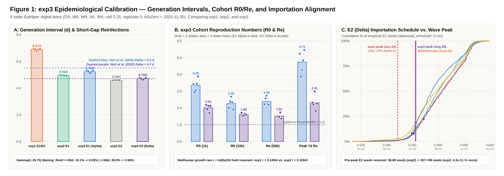
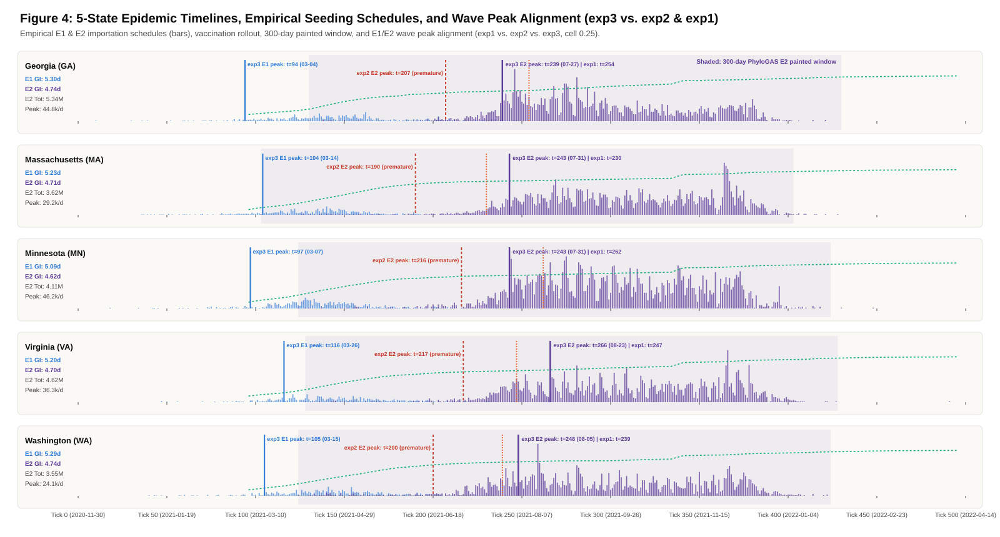
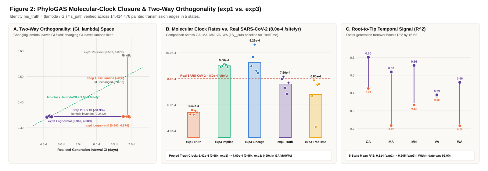
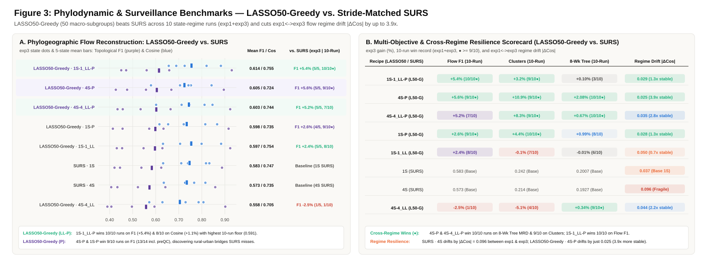

# PhyloGAS `exp3` Multi-State Characterization & Benchmark Report

> **Backing Script:** Generated reproducibly by [`scripts/utils/characterize_exp3.py`](../../scripts/utils/characterize_exp3.py).
> **Canonical Metrics & Recipes Reference:** **[`docs/benchmarks_and_metrics.md`](../benchmarks_and_metrics.md)** (full mathematical definitions), **[`docs/clock_modes.md`](../clock_modes.md)** (clock decomposition), and **[`docs/abm_contribution.md`](../abm_contribution.md)** (two-way orthogonality identity).
> **ABM Ground-Truth Deposit (v2 / `exp3`):** [`10.5281/zenodo.23989650`](https://doi.org/10.5281/zenodo.23989650) (Concept DOI: [`10.5281/zenodo.23067669`](https://doi.org/10.5281/zenodo.23067669))
> **Downstream PhyloGAS Outputs & Benchmarks Deposit (`exp3`):** [`10.5281/zenodo.24013208`](https://doi.org/10.5281/zenodo.24013208)

---

## 1. Epidemiological & Waning Calibration (`exp1` vs. `exp2` vs. `exp3`)

### Per-State Importation, Vaccination, & Peak Alignment Timelines

# Table 1: `exp3` Epidemiological Characterization Across 5 State Digital Twins

Generated by `scripts/utils/characterize_exp3.py` (`tickZero = 2020-11-30`, cell `0.25`, replicate `0`).

| State | `E1` Total | `E1` GI (d) | `E1` $R_0(1\text{k})$ / $R_0(10\text{k})$ | `E1` Peak Date | `E2` Total | `E2` GI (d) | `E2` $R_0(1\text{k})$ / $R_0(10\text{k})$ | `E2` Peak Date (Peak/day) | `E2` Seeds $\le$ Peak (`exp3` vs `exp2`) | Window Reinf % | Gaps $\le 30\text{d}$ / $\le 60\text{d}$ |
| :--- | :---: | :---: | :---: | :---: | :---: | :---: | :---: | :---: | :---: | :---: | :---: |
| GA | 4,408,224 | 5.30 d | `3.41` / `2.01` | `2021-03-04` (tick 94) | 5,342,451 | 4.74 d | `2.18` / `1.71` | `2021-07-27` (44,795/d) | **307 (8.1%)** vs. 45 (1.2%) | 16.0% | `0.03%` / `0.44%` |
| MA | 3,254,688 | 5.23 d | `2.94` / `2.39` | `2021-03-14` (tick 104) | 3,615,712 | 4.71 d | `1.92` / `1.52` | `2021-07-31` (29,200/d) | **392 (7.9%)** vs. 36 (0.7%) | 11.4% | `0.03%` / `0.63%` |
| MN | 3,513,248 | 5.09 d | `3.06` / `2.67` | `2021-03-07` (tick 97) | 4,108,415 | 4.62 d | `2.12` / `1.55` | `2021-07-31` (46,196/d) | **348 (7.8%)** vs. 81 (1.8%) | 16.9% | `0.03%` / `0.62%` |
| VA | 3,808,552 | 5.20 d | `3.45` / `2.34` | `2021-03-26` (tick 116) | 4,617,163 | 4.70 d | `1.70` / `1.65` | `2021-08-23` (36,253/d) | **749 (22.5%)** vs. 64 (1.9%) | 15.1% | `0.03%` / `0.56%` |
| WA | 3,100,280 | 5.29 d | `3.88` / `1.90` | `2021-03-15` (tick 105) | 3,548,756 | 4.74 d | `2.12` / `1.59` | `2021-08-05` (24,119/d) | **702 (18.8%)** vs. 89 (2.4%) | 12.5% | `0.03%` / `0.55%` |
| **MEAN** | 3,616,998 | **5.22 d** | `3.35` / `2.26` | `2021-03-13` (tick 103.2) | 4,246,499 | **4.70 d** | `2.01` / `1.60` | `2021-08-05` (36,113/d) | **500 (13.0%)** vs. 63 (1.6%) | 14.4% | `0.03%` / `0.56%` |

> **Section 1 Metric Legend (see [`docs/benchmarks_and_metrics.md` §2](../benchmarks_and_metrics.md#2-abm-epidemiological--waning-characterization-metrics)):**
> - **`GI (d)`:** Realized mean generation interval $t_{\text{exposed}}(\text{child}) - t_{\text{exposed}}(\text{parent})$ across all ABM transmission edges (`5.22 d` for `E1`, `4.70 d` for `E2` in `exp3` vs. `6.87 d` in `exp1`).
> - **$R_0(1\text{k})$ / $R_0(10\text{k})$:** Mean secondary infections per index case across the first $1{,}000$ and $10{,}000$ wave exposures.
> - **`E2 Seeds <= Peak`:** Empirical `E2` importation events arriving on or before the simulated `E2` daily incidence peak (`13.0%` in `exp3` vs. `1.6%` in `exp2`).
> - **`Window Reinf %` & `Gaps <= 30d / <= 60d`:** Share of painted-window `E2` cases that are repeat infections on the same host, and the fraction of repeat infections occurring within $\le 30\text{d}$ (`0.03%` under `Gamma(4, 45.75)` waning in `exp3`) or $\le 60\text{d}$ (`0.56%`).

---

## 2. Molecular-Clock Closure & Two-Way Orthogonality

# Table 2: Molecular-Clock Decomposition (`exp1` Baseline vs. Pre-Run Prediction vs. Measured `exp3`)

Generated by `scripts/utils/characterize_exp3.py`. Baseline TreeTime clock (`mu_sim`) is reported on `1S__surs` (random surveillance baseline), separately from `1S-P__lasso_greedy`.

| State | Painted Edges (`exp3`) | $\hat{\lambda}$ (`exp1` $\to$ `exp3`) | GI (`exp1` $\to$ `exp3`) | Implied $\lambda/\text{GI}$ (`/yr` \| `/site/yr`) | Within-Chain $\mu_{\text{lineage}}$ (`/site/yr`) | Path Factor $s_{\text{path}}$ | Pooled Truth $\mu_{\text{truth}}$ (`/site/yr`, vs. `8e-4`) | TreeTime $\mu_{\text{sim}}$ (`1S__surs` \| `1S-P__lasso`) | Root-to-Tip $R^2$ (`exp1` $\to$ `exp3`) |
| :--- | :---: | :---: | :---: | :---: | :---: | :---: | :---: | :---: | :---: |
| GA | 3,874,013 | `0.3415` $\to$ `0.3433` | `6.93 d` $\to$ `4.72 d` | `26.53` \| `8.92e-04` | `8.95e-04` | `0.894` | `7.98e-04` (1.00x) | `6.67e-04` \| `7.37e-04` | `0.425` $\to$ `0.601` |
| MA | 2,067,299 | `0.3423` $\to$ `0.3434` | `6.88 d` $\to$ `4.69 d` | `26.74` \| `8.99e-04` | `9.68e-04` | `0.908` | `8.16e-04` (1.02x) | `7.88e-04` \| `7.00e-04` | `0.217` $\to$ `0.518` |
| MN | 2,985,515 | `0.3436` $\to$ `0.3412` | `6.76 d` $\to$ `4.60 d` | `27.09` \| `9.11e-04` | `1.06e-03` | `0.801` | `7.30e-04` (0.91x) | `4.31e-04` \| `4.31e-04` | `0.332` $\to$ `0.556` |
| VA | 3,159,069 | `0.3433` $\to$ `0.3457` | `6.88 d` $\to$ `4.67 d` | `27.00` \| `9.08e-04` | `8.62e-04` | `0.753` | `6.84e-04` (0.85x) | `7.54e-04` \| `7.72e-04` | `0.382` $\to$ `0.389` |
| WA | 2,328,580 | `0.3436` $\to$ `0.3424` | `6.91 d` $\to$ `4.73 d` | `26.43` \| `8.89e-04` | `8.44e-04` | `0.867` | `7.71e-04` (0.96x) | `7.58e-04` \| `7.92e-04` | `0.216` $\to$ `0.460` |
| **MEAN (5 States)** | 2,882,895 | `0.3429` $\to$ **`0.3432`** | `6.87 d` $\to$ **`4.68 d`** | **`26.76`** \| `9.00e-04` | `9.26e-04` | `0.844` | **`7.60e-04` (0.95x)** | `6.80e-04` \| `6.86e-04` | `0.314` $\to$ **`0.505`** |
| **PRE-RUN PREDICTION** | 2,882,895 | `0.3428` $\to$ **`0.3430`** | `6.87 d` $\to$ **`4.69 d`** | **`26.60`** \| `8.91e-04` | `8.91e-04` | `0.885` | **`7.89e-04` (0.99x)** | `7.89e-04` \| `7.89e-04` | `0.314` $\to$ **`0.450`** |

> **Section 2 Metric Legend (see [`docs/benchmarks_and_metrics.md` §3](../benchmarks_and_metrics.md#3-molecular-clock-closure--sequence-divergence-metrics), [`docs/clock_modes.md`](../clock_modes.md), and [`docs/abm_contribution.md`](../abm_contribution.md)):**
> - **Closure Identity:** $\mu_{\text{truth}} = \frac{\hat{\lambda}}{\text{GI}} \cdot \frac{365.25}{L} \cdot s_{\text{path}}$, where $\hat{\lambda}$ is the per-transmission substitution count owned by the Genetic Painter (`0.3432`), $\text{GI}$ is the generation interval owned by EpiHiper (`4.68 d`), and $s_{\text{path}}$ (`0.844`) is the emergent path-length/coexistence factor.
> - **$\mu_{\text{lineage}}$ vs. $\mu_{\text{truth}}$ vs. $\mu_{\text{sim}}$:** $\mu_{\text{lineage}}$ is the fixed-effects within-chain root-to-tip slope; $\mu_{\text{truth}}$ is the pooled root-to-tip OLS slope directly on the painted FASTA (`7.60e-4` subs/site/yr, `0.95x` of the canonical SARS-CoV-2 `8.0e-4` clock); $\mu_{\text{sim}}$ is TreeTime's unconstrained clock estimate on the reconstructed tree.

---

## 3. Phylodynamic & Surveillance Sampling Benchmarks (`LASSO50-Greedy` vs. `SURS`)

### Nomenclature Note: `LASSO50-Greedy` vs. Alternative Allocation Families

Throughout these benchmarks, **`LASSO50-Greedy`** denotes our default LASSO regression + Greedy submodular optimization allocator configured with **`50` LASSO macro-subgroups** (distinct from `LASSO50-Stratified`, fine-grained `LASSO1500-Greedy`, proportional `Stratified` quota sampling, and Simple Uniform Random Sampling `SURS`; see [`docs/benchmarks_and_metrics.md` §1](../benchmarks_and_metrics.md#1-surveillance-sampling-recipes-scenario__algorithm)). Each recipe combines an allocation algorithm with a target scenario (`<Stride>-<Target>`):
- `1S` / `4S`: 1-week vs. 4-week temporal pooling stride.
- `P`: Census population target distribution (`Pop`).
- `1_LL` / `4_LL`: Empirical clinical line-list incidence target (`Line List`).
- `1_LL-P` / `4_LL-P`: 50/50 blended line-list incidence + census population target.

### Key Insights: Cross-Regime Resilience (`exp1` vs. `exp3`) & The Complementary Strengths of `LASSO50-Greedy`

1. **Cross-Regime Resilience (`|ΔCos|` Across Epidemic Regimes) — Why `SURS` Is Regime-Fragile While `LASSO50-Greedy` Is Regime-Stable:**
   - Because Simple Uniform Random Sampling (`SURS`) passively mirrors whatever spatiotemporal distortion the epidemic + clinical ascertainment filter produces, **`SURS · 4S` suffers a massive per-state flow reconstruction swing (`mean |ΔCos| = 0.096`, max `0.109`)** when disease dynamics change from exponential waning (`exp1`, where rapid urban reinfection loops dominate 52–59% of cases) to Gamma waning (`exp3`).
   - By contrast, **`LASSO50-Greedy` actively enforces demographic and geographic macro-subgroup balance every stride**, making it **2.8x to 3.9x more resilient to epidemic regime shifts**:
     - **`LASSO50-Greedy · 4S-P`**: `mean |ΔCos| = 0.025` (**3.9x lower regime drift** than `SURS · 4S`).
     - **`LASSO50-Greedy · 1S-P`**: `mean |ΔCos| = 0.028` (5-state mean Cosine is `0.735` in `exp1` and `0.735` in `exp3` — virtually invariant).
     - **`LASSO50-Greedy · 1S-1_LL-P`**: `mean |ΔCos| = 0.029`, achieving the **highest worst-state Cosine floor (`0.591`)** across all 10 state-regime runs (`exp1` + `exp3`).
     - **`LASSO50-Greedy · 4S-4_LL-P`**: `mean |ΔCos| = 0.035` (**2.8x lower regime drift** than `SURS · 4S`, beating `SURS · 4S` on mean Cosine in both `exp1` and `exp3`).
2. **10-Run Cross-Experiment Dominance (`exp1` 5 States + `exp3` 5 States = 10 State-Regime Runs; 14 Runs Including `preQC`):**
   - **Flow Topology ($F_1$, Network Edge Recovery, $\uparrow$):** `LASSO50-Greedy · 1S-1_LL-P` beats `SURS · 1S` in **10 / 10 runs** (**13 / 14** including `preQC`); `LASSO50-Greedy · 4S-P` and `LASSO50-Greedy · 1S-P` each win **9 / 10 runs** (**13 / 14** including `preQC`).
   - **Flow Proportions (`Cosine`, $\uparrow$):** `LASSO50-Greedy · 1S-1_LL-P` beats `SURS · 1S` in **8 / 10 runs** (**10 / 14** including `preQC`) and ranks **#1 overall** in `exp3` on both Flow Topology ($F_1 = 0.614$) and Flow Proportions (Cosine $= 0.755$).
   - **Transmission Clusters Reached (`stride_component_coverage`, $\uparrow$):** `LASSO50-Greedy · 1S-P` wins **10 / 10 runs** (`+4.4%` in `exp3`); `LASSO50-Greedy · 4S-P` (`+10.9%`), `4S-4_LL-P` (`+8.3%`), and `1S-1_LL-P` (`+3.2%`) each win **9 / 10 runs** (and **5 / 5 states** in `exp3`).
   - **Demographic Equity Tree Coverage (`equity_Senior_65+` & `equity_Adult_18-49` MRD, $\uparrow$):** All four population-aware `LASSO50-Greedy` recipes (`4S-P` `+6.9%`, `1S-P` `+4.9%`, `4S-4_LL-P` `+3.7%`, and `1S-1_LL-P` `+2.9%`) win **10 / 10 runs (`5/5` in `exp1` + `5/5` in `exp3`)** on Senior 65+ and Adult 18–49 phylogenetic tree proximity, while blended `LL-P` (`1S-1_LL-P` and `4S-4_LL-P`) also wins **8 / 10 runs** on full-wave tree coverage $C_0$ MRD.
3. **Why Blended `LL-P` Outperforms Pure `P` on Cosine While Pure `P` Maximizes Network & Cluster Discovery:**
   - Nextstrain's symmetrized rate matrix $W_{ij} = \frac{1}{2\mu}(q_{ij}/\pi_j + q_{ji}/\pi_i)$ divides transition counts $q_{ij}$ by the equilibrium node share $\pi_j$. Pure census targeting (`4S-P`) forces samples into low-incidence rural counties ($\pi_j \ll 1$), discovering more true county-to-county introductions (**+5.6% $F_1$, +10.9% Clusters Reached**) but amplifying $q_{ij}/\pi_j$ intensity weights on sparse rural links when `exp3` has no urban reinfection trap. Blending census diversity with line-list incidence (`LL-P`) prevents rural $1/\pi_j$ weight inflation while preserving the **5/5 state sweep** on topological flow recovery, cluster discovery, and Senior/Adult tree coverage.

# Table 3: `exp3` Inter-County Phylogeographic Reconstruction & Cross-Experiment Resilience (`LASSO50-Greedy` vs. `SURS`)

Generated by `scripts/utils/characterize_exp3.py`. Ranked by 5-state mean Topological $F_1$ (flow network edge recovery). Relative gains (`%`) and state win counts (`exp3` `/5` and pooled `exp1+exp3` `/10`) are computed against the stride-matched `SURS` baseline (`SURS · 1S` or `SURS · 4S`). **Regime Drift $|\Delta\text{Cos}|$** measures mean per-state sensitivity when epidemic dynamics shift between `exp1` and `exp3` (lower = more regime-resilient).

| Strategy Recipe (`LASSO50-Greedy` vs. `SURS`) | Flow Topology $F_1$ ($\pm$ SD) | $F_1$ vs. `SURS` (`exp3` \| `10-Run`) | Flow Proportions Cosine ($\pm$ SD) | Cosine vs. `SURS` (`exp3` \| `10-Run`) | Regime Drift $|\Delta\text{Cos}|$ (`exp1` $\leftrightarrow$ `exp3`) | 10-Run Cosine Floor (Min) | GA Cos/$F_1$ | MA Cos/$F_1$ | MN Cos/$F_1$ | VA Cos/$F_1$ | WA Cos/$F_1$ |
| :--- | :---: | :---: | :---: | :---: | :---: | :---: | :---: | :---: | :---: | :---: | :---: |
| **LASSO50-Greedy · 1S-1_LL-P** (`1S-1_LL-P__lasso_greedy`) | **0.614** ($\pm 0.195$) | **+5.4%** (5/5 \| **10/10**) | **0.755** ($\pm 0.094$) | `+1.1%` (3/5 \| 8/10) | **0.029** | `0.591` | `0.657`/`0.451` | `0.883`/`0.930` | `0.726`/`0.561` | `0.689`/`0.472` | `0.821`/`0.659` |
| **LASSO50-Greedy · 4S-P** (`4S-P__lasso_greedy`) | **0.605** ($\pm 0.186$) | **+5.6%** (5/5 \| **9/10**) | **0.724** ($\pm 0.095$) | `-1.4%` (1/5 \| 6/10) | **0.025** | `0.559` | `0.579`/`0.427` | `0.842`/`0.895` | `0.753`/`0.558` | `0.705`/`0.476` | `0.742`/`0.668` |
| **LASSO50-Greedy · 4S-4_LL-P** (`4S-4_LL-P__lasso_greedy`) | **0.603** ($\pm 0.200$) | **+5.2%** (5/5 \| **7/10**) | **0.744** ($\pm 0.095$) | `+1.2%` (1/5 \| 6/10) | **0.035** | `0.558` | `0.602`/`0.434` | `0.846`/`0.923` | `0.747`/`0.534` | `0.712`/`0.457` | `0.812`/`0.664` |
| **LASSO50-Greedy · 1S-P** (`1S-P__lasso_greedy`) | **0.598** ($\pm 0.198$) | **+2.6%** (4/5 \| **9/10**) | **0.735** ($\pm 0.106$) | `-1.6%` (1/5 \| 3/10) | **0.028** | `0.586` | `0.616`/`0.414` | `0.867`/`0.916` | `0.721`/`0.572` | `0.654`/`0.456` | `0.815`/`0.634` |
| **LASSO50-Greedy · 1S-1_LL** (`1S-1_LL__lasso_greedy`) | **0.597** ($\pm 0.199$) | **+2.4%** (5/5 \| **8/10**) | **0.754** ($\pm 0.095$) | `+1.0%` (2/5 \| 3/10) | **0.050** | `0.557` | `0.632`/`0.431` | `0.884`/`0.923` | `0.752`/`0.547` | `0.706`/`0.454` | `0.799`/`0.629` |
| **SURS · 1S** (`1S__surs`) | **0.583** ($\pm 0.188$) | Baseline | **0.747** ($\pm 0.082$) | Baseline | **0.037** | `0.586` | `0.632`/`0.421` | `0.833`/`0.887` | `0.740`/`0.538` | `0.711`/`0.445` | `0.818`/`0.624` |
| **SURS · 4S** (`4S__surs`) | **0.573** ($\pm 0.184$) | Baseline | **0.735** ($\pm 0.066$) | Baseline | **0.096** | `0.533` | `0.635`/`0.407` | `0.730`/`0.858` | `0.767`/`0.523` | `0.728`/`0.434` | `0.815`/`0.642` |
| **LASSO50-Greedy · 4S-4_LL** (`4S-4_LL__lasso_greedy`) | **0.558** ($\pm 0.209$) | **-2.5%** (1/5 \| **1/10**) | **0.705** ($\pm 0.101$) | `-4.1%` (1/5 \| 3/10) | **0.044** | `0.507` | `0.572`/`0.390` | `0.786`/`0.902` | `0.730`/`0.497` | `0.629`/`0.407` | `0.807`/`0.595` |

---

# Table 4: `exp3` Epidemic Truth & Demographic Equity Coverage (`LASSO50-Greedy` vs. `SURS`)

Generated by `scripts/utils/characterize_exp3.py` (see [`docs/benchmarks_and_metrics.md`](../benchmarks_and_metrics.md#5-ground-truth-surveillance--phylogenetic-tree-coverage-metrics-auc_truth_rankingscsv)). For **Mean Reciprocal Distance (MRD)** tree-coverage metrics (`coverage_size_*`, `8_week_rolling_tree_coverage`, `equity_*`) and `stride_component_coverage` (Clusters Reached), **higher AUC ($\uparrow$) = closer phylogenetic proximity / greater cluster capture** (`1/(d+1)` along the true ABM transmission graph); for `stride_variant_prevalence_error` ($L_1$) and `cumulative_infections` (KL divergence), **lower AUC ($\downarrow$) = lower distribution error**.

| Strategy Recipe (`LASSO50-Greedy` vs. `SURS`) | Clusters Reached ($\uparrow$) (`exp3` \| `10-Run`) | Senior 65+ Equity MRD ($\uparrow$) (`exp3` \| `10-Run`) | Adult 18–49 Equity MRD ($\uparrow$) (`exp3` \| `10-Run`) | Tree Coverage $C_0$ MRD ($\uparrow$) (`exp3` \| `10-Run`) | 8-Wk Rolling Tree MRD ($\uparrow$) | Variant Prevalence $L_1$ ($\downarrow$) | Cumul. Infections KL ($\downarrow$) |
| :--- | :---: | :---: | :---: | :---: | :---: | :---: | :---: |
| **LASSO50-Greedy · 1S-1_LL-P** (`1S-1_LL-P__lasso_greedy`) | **0.2499** (`+3.2%`, 5/5 \| **9/10**) | **0.2079** (`+2.9%`, 5/5 \| **10/10**) | `0.1933` (`+0.6%`, 5/5 \| **10/10**) | `0.2021` (3/5 \| **8/10**) | `0.2005` | **0.1586** | `0.4815` |
| **LASSO50-Greedy · 4S-P** (`4S-P__lasso_greedy`) | **0.2373** (`+10.9%`, 5/5 \| **9/10**) | **0.2235** (`+6.9%`, 5/5 \| **10/10**) | `0.2036` (`+1.8%`, 5/5 \| **10/10**) | `0.1923` (0/5 \| **4/10**) | `0.1887` | **0.1350** | `0.5487` |
| **LASSO50-Greedy · 4S-4_LL-P** (`4S-4_LL-P__lasso_greedy`) | **0.2317** (`+8.3%`, 5/5 \| **9/10**) | **0.2168** (`+3.7%`, 5/5 \| **10/10**) | `0.2020` (`+1.0%`, 5/5 \| **10/10**) | `0.1944` (4/5 \| **8/10**) | `0.1915` | **0.0978** | `0.4618` |
| **LASSO50-Greedy · 1S-P** (`1S-P__lasso_greedy`) | **0.2528** (`+4.4%`, 5/5 \| **10/10**) | **0.2118** (`+4.9%`, 5/5 \| **10/10**) | `0.1965` (`+2.2%`, 5/5 \| **10/10**) | `0.2011` (2/5 \| **5/10**) | `0.1987` | **0.1848** | `0.5445` |
| **LASSO50-Greedy · 1S-1_LL** (`1S-1_LL__lasso_greedy`) | **0.2421** (`-0.1%`, 3/5 \| **7/10**) | **0.2023** (`+0.2%`, 4/5 \| **7/10**) | `0.1919` (`-0.2%`, 1/5 \| **5/10**) | `0.2017` (1/5 \| **4/10**) | `0.2007` | **0.1469** | `0.4674` |
| **SURS · 1S** (`1S__surs`) | **0.2422** (Base) | **0.2020** (Base) | `0.1923` (Base) | `0.2019` (Base) | `0.2007` | **0.1444** | `0.4614` |
| **SURS · 4S** (`4S__surs`) | **0.2140** (Base) | **0.2091** (Base) | `0.1999` (Base) | `0.1942` (Base) | `0.1927` | **0.0680** | `0.4017` |
| **LASSO50-Greedy · 4S-4_LL** (`4S-4_LL__lasso_greedy`) | **0.2030** (`-5.1%`, 1/5 \| **4/10**) | **0.2071** (`-0.9%`, 1/5 \| **3/10**) | `0.1998` (`-0.1%`, 2/5 \| **4/10**) | `0.1940` (2/5 \| **2/10**) | `0.1921` | **0.0877** | `0.4502` |

> **Section 3 Metric Legend (see [`docs/benchmarks_and_metrics.md` §§4–5](../benchmarks_and_metrics.md#4-phylogeographic-flow-reconstruction-metrics-mugration_metricscsv)):**
> - **Flow Topology $F_1$ ($\uparrow$) & Flow Cosine ($\uparrow$):** Evaluated on the off-diagonal county-to-county transition vectors $\mathbf{t}, \mathbf{w} \in \mathbb{R}^{N(N-1)}$ ([`scoring.py`](../../src/phylogas/benchmark/scoring.py)). $F_1$ scores binary recovery of active inter-county transmission links; Cosine scores agreement of relative inter-county flow intensities.
> - **Regime Drift $|\Delta\text{Cos}|$ ($\downarrow$) & 10-Run Cosine Floor ($\uparrow$):** Mean per-state shift $|\text{Cos}_{s,\text{exp3}} - \text{Cos}_{s,\text{exp1}}|$ across the 5 states, and the minimum single-state Cosine across all 10 post-QC state-regime runs.
> - **Clusters Reached (`stride_component_coverage`, $\uparrow$):** Fraction of active ground-truth imported transmission chains per stride captured by at least one sequenced genome ([`truth_runner.py`](../../src/phylogas/benchmark/truth_runner.py)).
> - **Tree Coverage & Demographic Equity MRD (`coverage_size_0`, `8_week_rolling_tree_coverage`, `equity_*`, $\uparrow$):** Span-normalized AUC of **Mean Reciprocal Distance** $\text{MRD}(P_t, S) = \frac{1}{|P_t|}\sum_{u \in P_t} \frac{1}{d_G(u, S) + 1}$ along the true ABM transmission graph ($1.0$ = every infection directly sequenced; higher = closer phylogenetic proximity).
> - **Variant Prevalence $L_1$ (`stride_variant_prevalence_error`, $\downarrow$) & Cumul. Infections KL (`cumulative_infections`, $\downarrow$):** Total variation ($L_1$) error on benchmark sub-lineage proportions and Kullback–Leibler divergence on demographic $\times$ county infection distributions (lower = lower estimation error).
