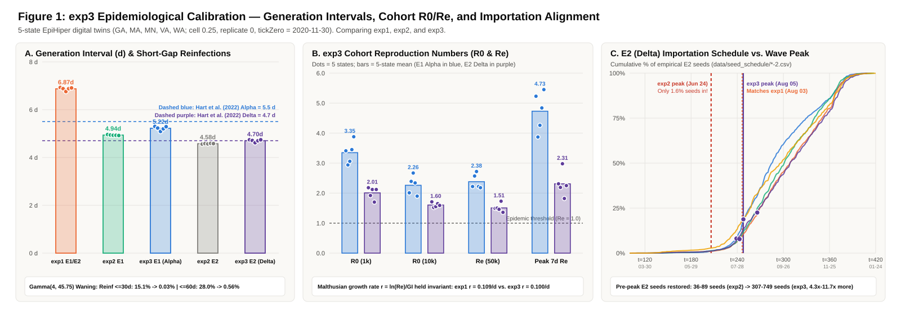
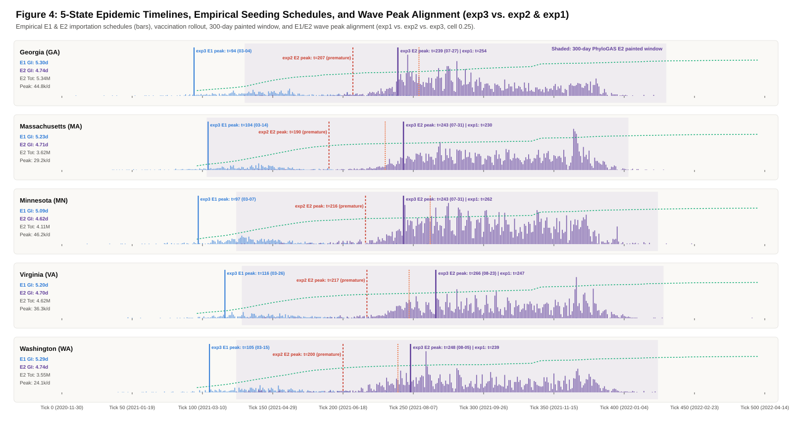
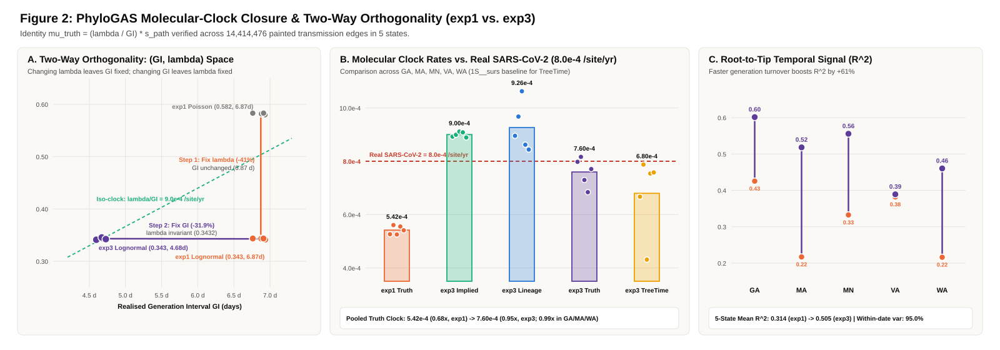
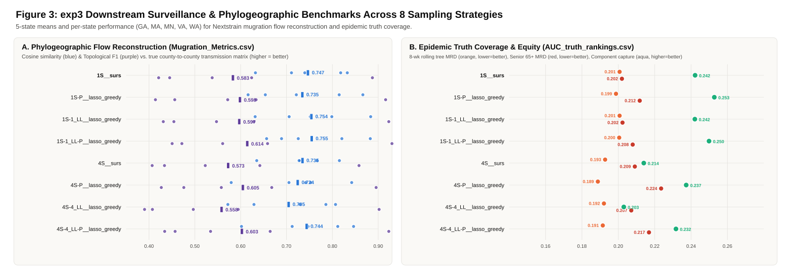

# PhyloGAS `exp3` Multi-State Characterization & Benchmark Report

> **Backing Script:** Generated reproducibly by [`scripts/utils/characterize_exp3.py`](../../scripts/utils/characterize_exp3.py).
> **ABM Ground-Truth Deposit (v2 / `exp3`):** [`10.5281/zenodo.23989650`](https://doi.org/10.5281/zenodo.23989650) (Concept DOI: [`10.5281/zenodo.23067669`](https://doi.org/10.5281/zenodo.23067669))
> **Downstream PhyloGAS Outputs & Benchmarks Deposit (`exp3`):** [`10.5281/zenodo.24013208`](https://doi.org/10.5281/zenodo.24013208)

---

## 1. Epidemiological & Waning Calibration (`exp1` vs. `exp2` vs. `exp3`)

### Per-State Importation, Vaccination, & Peak Alignment Timelines

# Table 1: `exp3` Epidemiological Characterization Across 5 State Digital Twins

Generated by `scripts/utils/characterize_exp3.py` (`tickZero = 2020-11-30`, cell `0.25`, replicate `0`).

| State | `E1` Total | `E1` GI (d) | `E1` $R_0(1\text{k})$ / $R_0(10\text{k})$ | `E1` Peak Date | `E2` Total | `E2` GI (d) | `E2` $R_0(1\text{k})$ / $R_0(10\text{k})$ | `E2` Peak Date (Peak/day) | `E2` Seeds $\le$ Peak (`exp3` vs `exp2`) | Window Reinf % | Gaps $\le 30\text{d}$ / $\le 60\text{d}$ |
| :--- | :---: | :---: | :---: | :---: | :---: | :---: | :---: | :---: | :---: | :---: | :---: |
| GA | 4,408,224 | 5.30 d | `3.41` / `2.01` | `2021-03-04` (tick 94) | 5,342,451 | 4.74 d | `2.18` / `1.71` | `2021-07-27` (44,795/d) | **307 (8.1%)** vs. 45 (1.2%) | 16.0% | `0.03%` / `0.44%` |
| MA | 3,254,688 | 5.23 d | `2.94` / `2.39` | `2021-03-14` (tick 104) | 3,615,712 | 4.71 d | `1.92` / `1.52` | `2021-07-31` (29,200/d) | **392 (7.9%)** vs. 36 (0.7%) | 11.4% | `0.03%` / `0.63%` |
| MN | 3,513,248 | 5.09 d | `3.06` / `2.67` | `2021-03-07` (tick 97) | 4,108,415 | 4.62 d | `2.12` / `1.55` | `2021-07-31` (46,196/d) | **348 (7.8%)** vs. 81 (1.8%) | 16.9% | `0.03%` / `0.62%` |
| VA | 3,808,552 | 5.20 d | `3.45` / `2.34` | `2021-03-26` (tick 116) | 4,617,163 | 4.70 d | `1.70` / `1.65` | `2021-08-23` (36,253/d) | **749 (22.5%)** vs. 64 (1.9%) | 15.1% | `0.03%` / `0.56%` |
| WA | 3,100,280 | 5.29 d | `3.88` / `1.90` | `2021-03-15` (tick 105) | 3,548,756 | 4.74 d | `2.12` / `1.59` | `2021-08-05` (24,119/d) | **702 (18.8%)** vs. 89 (2.4%) | 12.5% | `0.03%` / `0.55%` |
| **MEAN** | 3,616,998 | **5.22 d** | `3.35` / `2.26` | `2021-03-13` (tick 103.2) | 4,246,499 | **4.70 d** | `2.01` / `1.60` | `2021-08-05` (36,113/d) | **500 (13.0%)** vs. 63 (1.6%) | 14.4% | `0.03%` / `0.56%` |

---

## 2. Molecular-Clock Closure & Two-Way Orthogonality

# Table 2: Molecular-Clock Decomposition (`exp1` Baseline vs. Pre-Run Prediction vs. Measured `exp3`)

Generated by `scripts/utils/characterize_exp3.py`. Baseline TreeTime clock (`mu_sim`) is reported on `1S__surs` (random surveillance baseline), separately from `1S-P__lasso_greedy`.

| State | Painted Edges (`exp3`) | $\hat{\lambda}$ (`exp1` $\to$ `exp3`) | GI (`exp1` $\to$ `exp3`) | Implied $\lambda/\text{GI}$ (`/yr` \| `/site/yr`) | Within-Chain $\mu_{\text{lineage}}$ (`/site/yr`) | Path Factor $s_{\text{path}}$ | Pooled Truth $\mu_{\text{truth}}$ (`/site/yr`, vs. `8e-4`) | TreeTime $\mu_{\text{sim}}$ (`1S__surs` \| `1S-P__lasso`) | Root-to-Tip $R^2$ (`exp1` $\to$ `exp3`) |
| :--- | :---: | :---: | :---: | :---: | :---: | :---: | :---: | :---: | :---: |
| GA | 3,874,013 | `0.3415` $\to$ `0.3433` | `6.93 d` $\to$ `4.72 d` | `26.53` \| `8.92e-04` | `8.95e-04` | `0.894` | `7.98e-04` (1.00x) | `6.67e-04` \| `7.37e-04` | `0.425` $\to$ `0.601` |
| MA | 2,067,299 | `0.3423` $\to$ `0.3434` | `6.88 d` $\to$ `4.69 d` | `26.74` \| `8.99e-04` | `9.68e-04` | `0.908` | `8.16e-04` (1.02x) | `7.88e-04` \| `7.00e-04` | `0.217` $\to$ `0.518` |
| MN | 2,985,515 | `0.3436` $\to$ `0.3412` | `6.76 d` $\to$ `4.60 d` | `27.09` \| `9.11e-04` | `1.06e-03` | `0.801` | `7.30e-04` (0.91x) | `4.31e-04` \| `4.31e-04` | `0.332` $\to$ `0.556` |
| VA | 3,159,069 | `0.3433` $\to$ `0.3457` | `6.88 d` $\to$ `4.67 d` | `27.00` \| `9.08e-04` | `8.62e-04` | `0.753` | `6.84e-04` (0.85x) | `7.54e-04` \| `7.72e-04` | `0.382` $\to$ `0.389` |
| WA | 2,328,580 | `0.3436` $\to$ `0.3424` | `6.91 d` $\to$ `4.73 d` | `26.43` \| `8.89e-04` | `8.44e-04` | `0.867` | `7.71e-04` (0.96x) | `7.58e-04` \| `7.92e-04` | `0.216` $\to$ `0.460` |
| **MEAN (5 States)** | 2,882,895 | `0.3429` $\to$ **`0.3432`** | `6.87 d` $\to$ **`4.68 d`** | **`26.76`** \| `9.00e-04` | `9.26e-04` | `0.844` | **`7.60e-04` (0.95x)** | `6.80e-04` \| `6.86e-04` | `0.314` $\to$ **`0.505`** |
| **PRE-RUN PREDICTION** | 2,882,895 | `0.3428` $\to$ **`0.3430`** | `6.87 d` $\to$ **`4.69 d`** | **`26.60`** \| `8.91e-04` | `8.91e-04` | `0.885` | **`7.89e-04` (0.99x)** | `7.89e-04` \| `7.89e-04` | `0.314` $\to$ **`0.450`** |

---

## 3. Phylodynamic & Surveillance Sampling Benchmarks

# Table 3: `exp3` Inter-County Phylogeographic Reconstruction (`Mugration_Metrics.csv`)

Generated by `scripts/utils/characterize_exp3.py`.

| Sampling Strategy | 5-State Mean Cosine ($\pm$ SD) | 5-State Mean Topo $F_1$ ($\pm$ SD) | Mean Pearson $r$ | GA Cosine / $F_1$ | MA Cosine / $F_1$ | MN Cosine / $F_1$ | VA Cosine / $F_1$ | WA Cosine / $F_1$ |
| :--- | :---: | :---: | :---: | :---: | :---: | :---: | :---: | :---: |
| `1S__surs` | **0.747** ($\pm 0.082$) | **0.583** ($\pm 0.188$) | `0.721` | `0.632` / `0.421` | `0.833` / `0.887` | `0.740` / `0.538` | `0.711` / `0.445` | `0.818` / `0.624` |
| `1S-P__lasso_greedy` | **0.735** ($\pm 0.106$) | **0.598** ($\pm 0.198$) | `0.712` | `0.616` / `0.414` | `0.867` / `0.916` | `0.721` / `0.572` | `0.654` / `0.456` | `0.815` / `0.634` |
| `1S-1_LL__lasso_greedy` | **0.754** ($\pm 0.095$) | **0.597** ($\pm 0.199$) | `0.733` | `0.632` / `0.431` | `0.884` / `0.923` | `0.752` / `0.547` | `0.706` / `0.454` | `0.799` / `0.629` |
| `1S-1_LL-P__lasso_greedy` | **0.755** ($\pm 0.094$) | **0.614** ($\pm 0.195$) | `0.734` | `0.657` / `0.451` | `0.883` / `0.930` | `0.726` / `0.561` | `0.689` / `0.472` | `0.821` / `0.659` |
| `4S__surs` | **0.735** ($\pm 0.066$) | **0.573** ($\pm 0.184$) | `0.703` | `0.635` / `0.407` | `0.730` / `0.858` | `0.767` / `0.523` | `0.728` / `0.434` | `0.815` / `0.642` |
| `4S-P__lasso_greedy` | **0.724** ($\pm 0.095$) | **0.605** ($\pm 0.186$) | `0.698` | `0.579` / `0.427` | `0.842` / `0.895` | `0.753` / `0.558` | `0.705` / `0.476` | `0.742` / `0.668` |
| `4S-4_LL__lasso_greedy` | **0.705** ($\pm 0.101$) | **0.558** ($\pm 0.209$) | `0.674` | `0.572` / `0.390` | `0.786` / `0.902` | `0.730` / `0.497` | `0.629` / `0.407` | `0.807` / `0.595` |
| `4S-4_LL-P__lasso_greedy` | **0.744** ($\pm 0.095$) | **0.603** ($\pm 0.200$) | `0.719` | `0.602` / `0.434` | `0.846` / `0.923` | `0.747` / `0.534` | `0.712` / `0.457` | `0.812` / `0.664` |

---

# Table 4: `exp3` Epidemic Truth & Demographic Equity Coverage (`AUC_truth_rankings.csv`)

Generated by `scripts/utils/characterize_exp3.py`. Note: For MRD/L1 error metrics (`8_week_rolling_tree_coverage`, `coverage_size_*`, `stride_variant_prevalence_error`, `cumulative_infections`, `equity_*`), **lower AUC = lower distributional divergence error**; for `stride_component_coverage`, **higher AUC = greater transmission component capture**.

| Sampling Strategy | 8-Wk Rolling Tree MRD ($\downarrow$) | Component Coverage ($\uparrow$) | Variant Prevalence L1 ($\downarrow$) | Tree Coverage $C_0$ MRD ($\downarrow$) | Senior 65+ Equity MRD ($\downarrow$) | Adult 18–49 Equity MRD ($\downarrow$) | Cumul. Infections MRD ($\downarrow$) |
| :--- | :---: | :---: | :---: | :---: | :---: | :---: | :---: |
| `1S__surs` | **0.2007** | **0.2422** | **0.1444** | `0.2019` | `0.2020` | `0.1923` | `0.4614` |
| `1S-P__lasso_greedy` | **0.1987** | **0.2528** | **0.1848** | `0.2011` | `0.2118` | `0.1965` | `0.5445` |
| `1S-1_LL__lasso_greedy` | **0.2007** | **0.2421** | **0.1469** | `0.2017` | `0.2023` | `0.1919` | `0.4674` |
| `1S-1_LL-P__lasso_greedy` | **0.2005** | **0.2499** | **0.1586** | `0.2021` | `0.2079` | `0.1933` | `0.4815` |
| `4S__surs` | **0.1927** | **0.2140** | **0.0680** | `0.1942` | `0.2091` | `0.1999` | `0.4017` |
| `4S-P__lasso_greedy` | **0.1887** | **0.2373** | **0.1350** | `0.1923` | `0.2235` | `0.2036` | `0.5487` |
| `4S-4_LL__lasso_greedy` | **0.1921** | **0.2030** | **0.0877** | `0.1940` | `0.2071` | `0.1998` | `0.4502` |
| `4S-4_LL-P__lasso_greedy` | **0.1915** | **0.2317** | **0.0978** | `0.1944` | `0.2168` | `0.2020` | `0.4618` |
